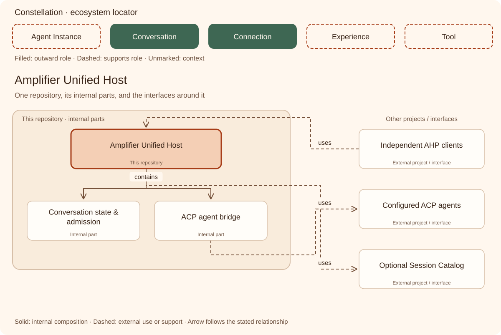

# Amplifier Unified Host

Connect browser and terminal clients to independently installed AI agents.
Unified Host keeps conversations and shared state available as clients connect,
disconnect, and reopen their work.

It speaks [Agent Host Protocol (AHP)](https://microsoft.github.io/agent-host-protocol/)
over WebSocket to clients and [Agent Client Protocol (ACP)](https://agentclientprotocol.com/)
over stdio to agents. This repository is for developers building or embedding a
host. For the assembled application, start with
[Amplifier Unified](https://github.com/microsoft/amplifier-unified).

## Try it locally

Use Node.js 22.16 or later. From a checkout:

```sh
npm ci
npm run build
node examples/offline-host.mjs /absolute/workspace /private/disposable-state 8765
```

This starts a local host with the included echo agent. Connect an AHP client to
`ws://127.0.0.1:8765/ahp`; the example accepts the local web-client origins on ports
5173 and 5179. It needs no provider account and makes no model calls. Stop the
process when you finish and use a separate state directory for real work.

## Connect a real agent

Install an ACP-compatible agent separately and configure its authentication using
that agent's setup instructions. Save a host configuration such as:

```json
{
  "stateDirectory": "/private/owned-instance/host",
  "host": "127.0.0.1",
  "port": 8765,
  "allowedWorkspaceRoots": ["/work"],
  "allowedOrigins": ["http://127.0.0.1:5173"],
  "engines": [{
    "id": "amplifier",
    "label": "Amplifier",
    "command": "/installation/bin/amplifier-acp",
    "args": ["--config", "/private/owned-instance/agent.json"]
  }]
}
```

Replace the paths and origin with your installation's values, then run:

```sh
node dist/cli.js --config /absolute/host.json
```

Engine commands are trusted administrator configuration. Clients select an
advertised engine; they cannot supply an arbitrary executable. For external
conversation discovery, configure the independent
[session catalog](https://github.com/microsoft/amplifier-session-catalog).
Without it, the host lists its own created records.

## Embedding and access

The package exports `createHost(config)` and methods for sessions, capability
invalidation, diagnostics, and shutdown. Optional capability packages add features
such as resources, MCP connections, and background operations.

Keep the default loopback bind for local use. A non-loopback bind requires
authentication. Browser deployment requires an authenticated same-origin gateway;
the host represents one authorized principal, not separate tenants. Keep bearer
tokens out of URLs. TLS and user-account management belong to the gateway.

## Reference

- [Host API and integration contract](docs/contracts/host-boundary.v1.md)
- [Independent ACP examples and checks](docs/interop-baseline.md)
- [Shared-service admission](docs/contracts/shared-service-admission.v1.md)
- [Persistent storage expectations](docs/authoritative-schema.md)

For development, run `npm run check` and `npm test`.


<!-- ecosystem-map:start -->
## Where this fits

A separately composable AHP host for clients, durable conversation state and independently installed ACP agents.

Roles: Conversation, Connection. Supports: Experience, Agent Instance, Tool.



[Product page](https://microsoft.github.io/amplifier-constellation/projects/amplifier-unified-host/) · [Open the map](docs/ecosystem-map.svg) · [Map guide](https://github.com/microsoft/amplifier-constellation/blob/main/docs/ecosystem-maps.md)

<details>
<summary>The five shared building blocks</summary>

[](https://microsoft.github.io/amplifier-constellation/)

</details>

<!-- ecosystem-map:end -->

## Contributing

Most contributions require you to agree to a
Contributor License Agreement (CLA) declaring that you have the right to, and actually do, grant us
the rights to use your contribution. For details, visit [Contributor License Agreements](https://cla.opensource.microsoft.com).

When you submit a pull request, a CLA bot will automatically determine whether you need to provide
a CLA and decorate the PR appropriately (e.g., status check, comment). Simply follow the instructions
provided by the bot. You will only need to do this once across all repos using our CLA.

This project has adopted the [Microsoft Open Source Code of Conduct](https://opensource.microsoft.com/codeofconduct/).
For more information see the [Code of Conduct FAQ](https://opensource.microsoft.com/codeofconduct/faq/) or
contact [opencode@microsoft.com](mailto:opencode@microsoft.com) with any additional questions or comments.

## Trademarks

This project may contain trademarks or logos for projects, products, or services. Authorized use of Microsoft
trademarks or logos is subject to and must follow
[Microsoft's Trademark & Brand Guidelines](https://www.microsoft.com/legal/intellectualproperty/trademarks/usage/general).
Use of Microsoft trademarks or logos in modified versions of this project must not cause confusion or imply Microsoft sponsorship.
Any use of third-party trademarks or logos are subject to those third-party's policies.
